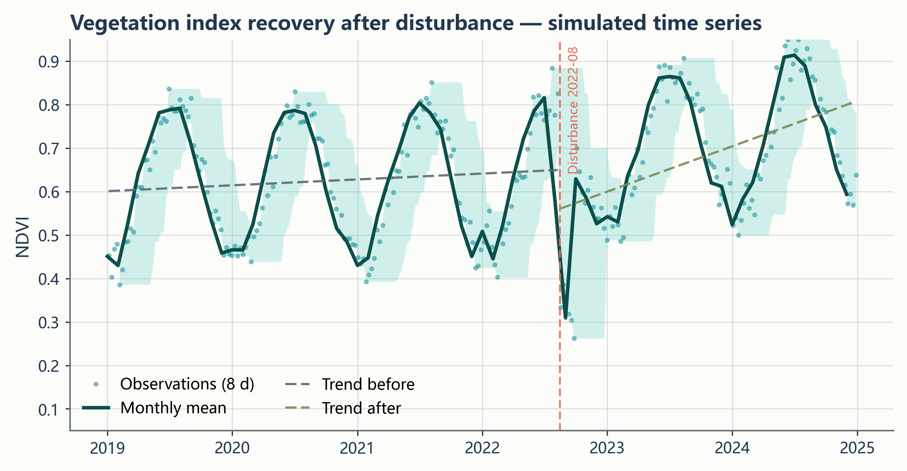
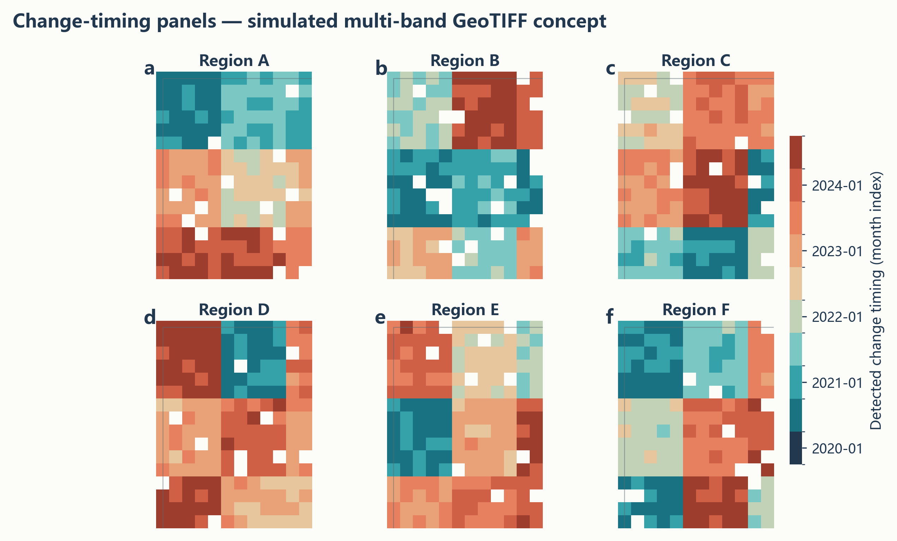
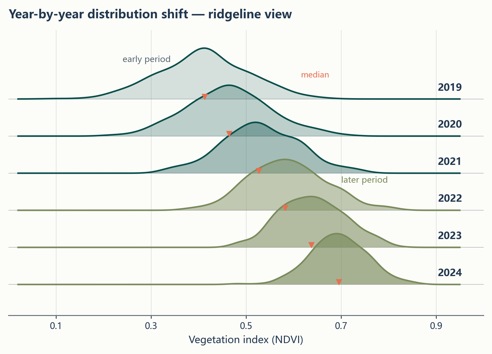
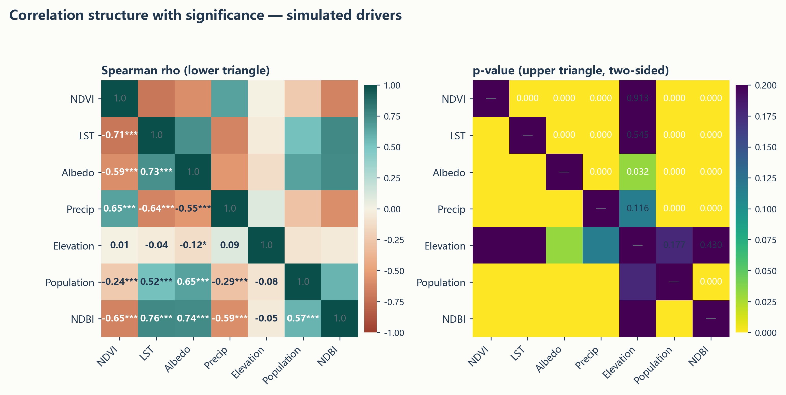
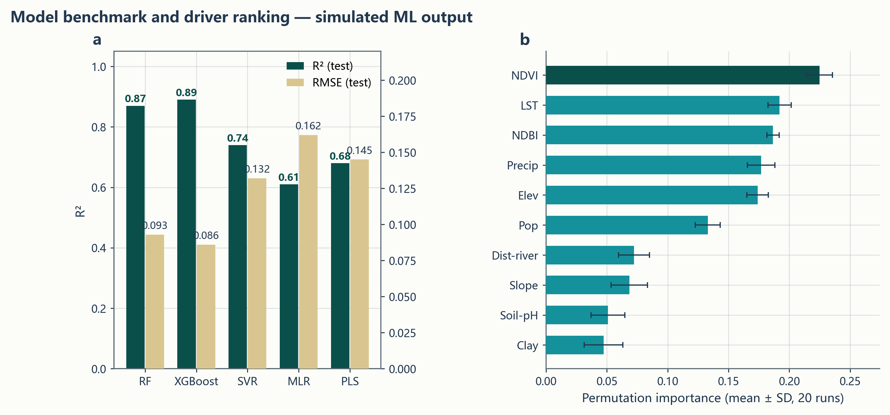
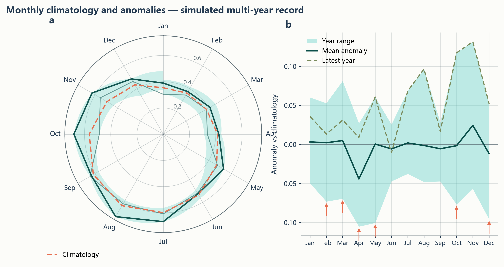

# geoviz-templates

**Publication-quality figure templates for geoscience & remote sensing papers.**

地球科学 / 遥感领域科研论文图表模板库 —— 一套统一设计语言的 matplotlib 模板与示例，开箱即用，改数据就能出图。

> All figures below are rendered from the code in [`examples/`](examples/) with **simulated data**.
> 每张图都由 `examples/` 中的脚本用**模拟数据**生成，可直接替换为你的真实数据。

---

## Gallery / 图库

| # | Template | Preview |
|---|----------|---------|
| 1 | Time series with disturbance & recovery<br/>时序断点与恢复趋势 |  |
| 2 | Regional change-timing panels<br/>区域变化时间小多边形组图 |  |
| 3 | Ridgeline distribution shift<br/>年度分布山脊图 |  |
| 4 | Correlation matrix with significance<br/>相关系数矩阵与显著性 |  |
| 5 | Model benchmark & feature importance<br/>模型对比与特征重要性 |  |
| 6 | Polar climatology & anomaly ribbon<br/>极坐标气候态与距平带 |  |

---

## Why this repo / 为什么做这个

Making figures for a paper is a *design* problem as much as a coding problem:
journals want 300 dpi, two-column layouts, color-blind-safe ramps and consistent
typography — but most example code on the internet stops at "it plots something".

做论文图其实一半是排版设计问题：期刊要求 300 dpi、统一字体、无障碍配色、
干净的分 panel 标注——而网上的示例代码大多只到"能画出来"为止。

This repo is a small **design system** + a gallery of finished templates:

- **One consistent visual language** across all figures (palette, grid, spines, fonts).
  所有图共享同一套视觉语言（配色、网格、边框、字体）。
- **Simulated data only** — every script is self-contained, no downloads, no
  proprietary data. 全部使用模拟数据，脚本自包含，无需下载任何外部数据。
- **Copy-paste workflow** — pick the template closest to your result, swap in
  your DataFrame, done. 选最接近你结果的模板，替换数据即可。
- **CJK-friendly** — works with Microsoft YaHei out of the box (no missing
  glyph squares for Chinese labels). 中文标签开箱即用，不会出现方框。

## Quickstart / 快速开始

```bash
git clone https://github.com/wuhaobiao8/geoviz-templates.git
cd geoviz-templates
pip install -r requirements.txt

# render every template / 渲染全部模板
python examples/fig1_timeseries_event.py
python examples/fig2_timing_panels.py
# ... or simply / 或逐个运行
```

All figures are written to `figures/` at **300 dpi** with `bbox_inches="tight"`.

## Use the style in your own script / 在你自己的脚本里用这套风格

```python
from geoviz_templates.style import use_style, PALETTE, panel_label, event_line

use_style()                      # apply the global design system

fig, ax = plt.subplots(figsize=(8, 4))
ax.plot(my_x, my_y, color=PALETTE["deep"])
event_line(ax, my_event_x, "My event")   # dashed event marker
panel_label(ax, "a")                     # bold panel letter
fig.savefig("my_fig.png")                # 300 dpi, tight bbox
```

## Design rules baked into the style / 内置的设计规则

| Rule | Value |
|------|-------|
| Resolution | 300 dpi, tight bounding box |
| Palette | original teal–coral–sand system (print-safe) |
| Spines | top/right removed; left/bottom 0.9 pt |
| Grid | 0.22 alpha, behind data |
| Fonts | Microsoft YaHei → DejaVu Sans fallback (CJK-safe) |
| Panel labels | bold `a b c...` letters, consistent offsets |
| Color ramps | sequential `GRADE_CMAP`, diverging `DIVERGE_CMAP`, continuous `CONT_CMAP` |

## Repo layout / 目录结构

```
geoviz-templates/
├── geoviz_templates/     # the style system (import this / 样式系统)
│   └── style.py
├── examples/             # one runnable script per template / 每个模板一个脚本
│   ├── fig1_timeseries_event.py
│   ├── fig2_timing_panels.py
│   ├── fig3_ridgeline.py
│   ├── fig4_correlation.py
│   ├── fig5_models.py
│   └── fig6_polar_season.py
├── figures/              # rendered output (300 dpi) / 输出图片
├── requirements.txt
├── LICENSE               # MIT
└── CITATION.cff
```

## Requirements / 依赖

- Python ≥ 3.10
- matplotlib ≥ 3.8, numpy, pandas, scipy

(see [requirements.txt](requirements.txt))

## Roadmap / 计划

- [ ] Add a GEE (JavaScript) export script that writes CSVs matching these templates
- [ ] Bivariate choropleth template
- [ ] Alluvial / class-transition template
- [ ] SVG output example for vector journals
- [ ] English/Chinese label switch helper

Contributions and star are welcome — issues and PRs are open.
欢迎 issue 和 PR，觉得有用请点个 star。

## License / 许可

[MIT](LICENSE) — free for academic and commercial use.
Cite as: see [CITATION.cff](CITATION.cff).

---

<details>
<summary><b>中文简介 / Chinese summary</b></summary>

这是一个面向地球科学与遥感论文的 matplotlib 图表模板库。
所有模板使用统一的设计语言：同一套原创建议配色（teal–coral–sand）、
300 dpi 输出、期刊友好的字号与边框、中文无乱码、panel 字母标注、
以及三套色带（分级/发散/连续）。

每个模板 = 一个可运行脚本 + 模拟数据，你只需要把 `simulate()` 换成
自己的 DataFrame 即可出图。模板覆盖：断点时序、区域变化时间组图、
山脊图、相关系数矩阵（含显著性星标）、模型对比与特征重要性、
极坐标气候态与距平。

</details>
